# Bhaargav K.C

**Web Developer | Full-Stack Builder | AI Enthusiast**

### Building useful products at the intersection of web engineering and AI.

I'm a **Computer Science and Business Systems student** at **R.M.K. Engineering College**. I enjoy turning ideas into practical software — from multi-agent AI platforms and scam-intelligence systems to collaborative web applications.

Currently exploring **React, TypeScript, Java, backend engineering, and AI-integrated applications**.

---

## 👨‍💻 About Me

---

## 🚀 Featured Projects

 

 

### More Projects

 

---

## 💼 Experience

### Java Developer Intern — Cognifyz Technologies

*Remote · May 2025 – June 2025*

- Developed Java applications applying OOP concepts including encapsulation, inheritance, polymorphism, and abstraction.
- Practised Java Collections Framework concepts and exception handling.
- Worked with Java I/O for file-based data persistence.
- Completed assigned development tasks in a remote internship environment.

### Web Development Intern — InternPe

*January 2025 – February 2025*

- Built and deployed responsive web interfaces for practical projects.
- Improved UI consistency and layout behaviour across screen sizes.
- Applied HTML, CSS, and JavaScript best practices.

### Tech Wing Member — Google Developer Group

*R.M.K. Engineering College · Since May 2026*

---

## 🧰 Tech Stack

**Languages**

**Frontend**

**Backend, Databases & AI**

**Tools & Platforms**

**Also working with:** LangGraph · LangChain · LangChain4j · RAG · Yjs · Tiptap · Prisma · REST APIs

---

## 🏆 Achievements & Certifications

- 🥈 **Second Place** — Yet Another Hackathon 2026, SVCE.
- 📄 **LOVRS Research Paper** — Published on IEEE Xplore; research on a fog-aware vehicle speed advisory system. [Read the paper](https://ieeexplore.ieee.org/document/11766931)
- 💡 **Nimirndhu Nil Hackathon** — Participated in the Ideation Camp organized with EDII-TN / TNYIEDP, Thiruvallur.
- 🎓 **Infosys Springboard** — Front-End Web Development certification.
- ☕ **HackerRank** — Java (Basic) certification.

---

## 🎓 Education

**R.M.K. Engineering College, Chennai**

B.Tech — Computer Science and Business Systems (CSBS)

2024 – 2028 · CGPA: **7.44 / 10**

---

## 📈 GitHub Analytics

---

## 🧮 LeetCode Stats

---

## 🔗 Coding Profiles

<a href="https://leetcode.com/u/Bhaargav07/">LeetCode</a> ·
<a href="https://www.hackerrank.com/profile/bhaargavkc">HackerRank</a> ·
<a href="https://codolio.com/profile/BHAARGAV07">Codolio</a> ·
<a href="https://github.com/BHAARGAV07">GitHub</a>

---

### 💬 Let's Connect & Build Something Meaningful

<a href="mailto:bhaargavkc@gmail.com">bhaargavkc@gmail.com</a>

*Build. Learn. Improve. Repeat.*

