# Bhaargav K.C

**Software Developer | Full-Stack & AI-Integrated Apps**

 

---

## `./projects`

| Project | What it does | Stack | Links |
| --- | --- | --- | --- |
| **Block-Safe** | Android-first scam detection and threat-intelligence platform. | `[add stack]` | [Repo](https://github.com/bhargava562/block-safe) |
| **Chakro AI VBDP** | `[add one line: the problem it solves]` | `[add stack]` | [Repo](https://github.com/bhargava562/Chakro-AI-VBDP) |
| **CollabNotes** | Notion-style real-time collaborative note-taking app. | `Yjs` `Tiptap` `Prisma` `[verify rest]` | [Repo](https://github.com/BHAARGAV07/collabnotes) |
| **Portfolio Website** | Personal full-stack portfolio with an AI project-assistant widget. | `[add stack]` | [Repo](REPO_URL) · [Live](LIVE_URL) |
| **Certificate Automation** | Backend-only plug-in system that generates and emails event certificates at scale. | `[add stack]` | [Repo](REPO_URL) |
| **Ocular Allergy Management App** | Personalised allergy management app with a rule-based trigger and risk engine. | `Flutter` `FastAPI` `PostgreSQL` | [Repo](REPO_URL) |

---

## Experience

### Java Developer Intern, Cognifyz Technologies

*Remote · May 2025 – June 2025*

- Developed Java applications applying OOP concepts including encapsulation, inheritance, polymorphism, and abstraction.
- Practised Java Collections Framework concepts and exception handling.
- Worked with Java I/O for file-based data persistence.

### Web Development Intern, InternPe

*January 2025 – February 2025*

- Built and deployed responsive web interfaces for practical projects.
- Improved UI consistency and layout behaviour across screen sizes.
- Applied HTML, CSS, and JavaScript best practices.

### Tech Wing Member, Google Developer Group

*R.M.K. Engineering College · Since May 2026*

---

## Tech Stack

**Languages**

**Frontend**

**Backend, Databases & AI**

**Tools & Platforms**

**Also working with:** LangGraph · LangChain · LangChain4j · RAG · Yjs · Tiptap · Prisma · REST APIs

---

## Achievements & Certifications

- 📄 **LOVRS Research Paper:** published on IEEE Xplore; research on a fog-aware vehicle speed advisory system. [Read the paper](https://ieeexplore.ieee.org/document/11766931)
- 🥈 **Second Place:** Yet Another Hackathon 2026, SVCE.
- 🎓 **Certifications:** Infosys Springboard (Front-End Web Development) · HackerRank (Java Basic)
- 💡 **Also:** Nimirndhu Nil Hackathon Ideation Camp, organized with EDII-TN / TNYIEDP, Thiruvallur.

---

## Education

**R.M.K. Engineering College, Chennai**

B.Tech, Computer Science and Business Systems (CSBS)

2024 – 2028 · CGPA: **7.44 / 10**

---

## Coding Profiles

 

<a href="https://leetcode.com/u/Bhaargav07/">LeetCode</a> ·
<a href="https://www.hackerrank.com/profile/bhaargavkc">HackerRank</a> ·
<a href="https://codolio.com/profile/BHAARGAV07">Codolio</a> ·
<a href="https://github.com/BHAARGAV07">GitHub</a>

---

### Open to software developer internships

<a href="mailto:bhaargavkc@gmail.com">bhaargavkc@gmail.com</a>

